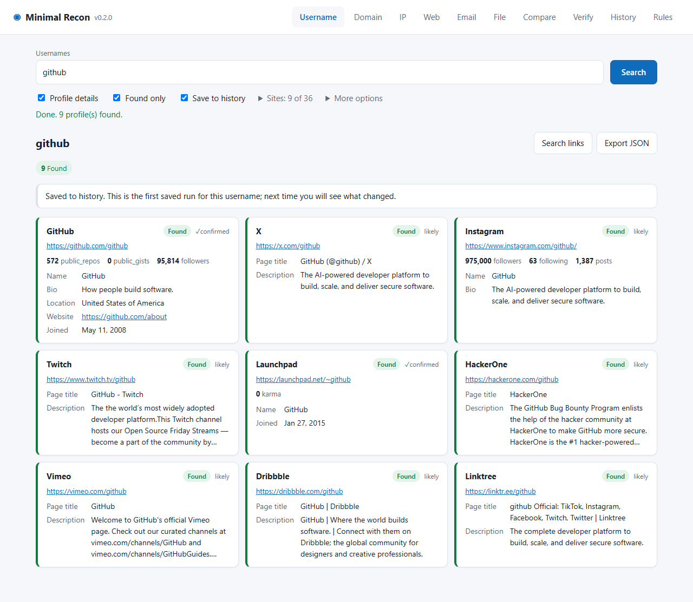
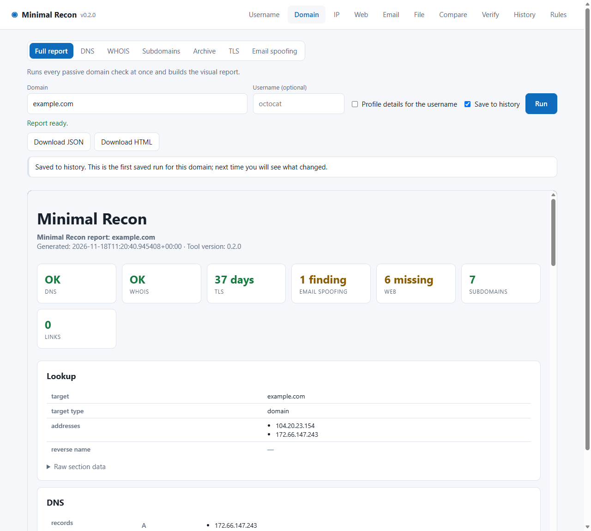

# Minimal Recon

[](https://github.com/AlexC0906/minimal-recon/actions/workflows/ci.yml)
[](LICENSE)


A passive, read-only OSINT toolkit for domains, IP addresses, web pages, email addresses
and usernames, with a command line and a local web interface. It reads public data the
way a browser or resolver would. It does not scan ports, brute-force paths, log in or
bypass protections.



## Highlights

- **One report for a domain:** DNS, WHOIS, subdomains from Certificate Transparency, TLS
  certificate, security headers, WAF and technology hints, SPF/DMARC/DKIM weaknesses,
  public files and Wayback history, as JSON or a visual HTML report.
- **Username footprint on 36 sites,** each with its own tested rule. Answers read from
  public APIs are marked `confirmed`, answers inferred from profile pages `likely`, and
  a self-test shows when a site change breaks a rule.
- **Monitoring:** saved runs, "what changed since last time", and `recon watch` alerts for
  new subdomains, DNS changes and expiring certificates.
- **Local web interface** with live results, history and every command, served on
  `127.0.0.1` only.
- **Privacy by design:** only what people chose to publish on a profile is read; email
  addresses, phone numbers, avatars and activity times are never collected, and opt-outs
  are respected.
- 225 automated tests, Ruff and mypy in CI on Python 3.9, 3.12 and 3.13.

## Quick start

```powershell
git clone https://github.com/AlexC0906/minimal-recon.git
cd minimal-recon
python -m venv .venv
.\.venv\Scripts\Activate.ps1          # macOS/Linux: source .venv/bin/activate
python -m pip install -e .
recon ui                               # opens http://127.0.0.1:8765/
```

Or straight from the command line:

```powershell
recon report example.com --html report.html
recon footprint octocat --found-only --details
recon --help
```

To install the `recon` command without a virtual environment, use
`pipx install git+https://github.com/AlexC0906/minimal-recon.git`.

## Web interface

`recon ui` opens the interface in your browser and keeps running until `Ctrl+C`.

| Tab | What it does |
| --- | --- |
| Username | Footprint on all sites or a selection, results appearing live as each site answers, profile details, search links, self-audit |
| Domain | Full report shown in the page (JSON and HTML download), or one check: DNS, WHOIS, subdomains, archive, TLS, email spoofing |
| IP | Lookup, geolocation, VirusTotal, Shodan |
| Web | Security headers and technologies, links on a page, public files |
| Email | Format, MX records, role and disposable-domain flags |
| File | Size, image format and EXIF of a file you choose, inspected locally |
| Compare | Differences between two saved JSON reports |
| Verify | Create a verification token and check it on your profiles |
| History | Saved searches and reports: view, compare with the previous run or any two, delete |
| Rules | Site-rule self-test |



Options: `recon ui --port 9000` for another port, `--no-browser` to open it yourself, and
`recon --timeout 30 ui` on slow networks. VirusTotal and Shodan use `VT_API_KEY` and
`SHODAN_API_KEY` from the environment, or a key typed into the form for that request
only; keys are never stored.

<details>
<summary>How the interface is protected</summary>

- It listens on `127.0.0.1` only, so other machines cannot reach it, and it refuses to
  share its port with another program.
- Each run creates a random API token that the page sends with every request, and
  requests with a different `Host` header are refused, so other websites open in the
  same browser cannot drive the tool.
- Text that comes from websites (titles, bios, headers) is always shown as text, never
  as HTML, and the page's Content Security Policy only allows its own scripts.
- It uses only the Python standard library; there is nothing extra to install.

</details>

## Command line

Every command supports `--help`, and most support `--json` for scripting. Domain
arguments are bare hostnames (`example.com`); `web`, `links`, `public-files` and `verify`
take full `https://` URLs. `--timeout SECONDS`, placed before the command, replaces the
default HTTP, DNS and TLS timeouts.

| Area | Commands |
| --- | --- |
| Domain | `report`, `dns`, `whois`, `subdomains`, `archive`, `tls`, `anti-spoofing` |
| IP | `lookup`, `geoip`, `reputation` (VirusTotal key), `shodan` (Shodan key) |
| Web | `web`, `links`, `public-files` |
| Email and files | `email`, `metadata` |
| Username | `footprint`, `search-links` |
| Ownership | `verify-token`, `verify` |
| Over time | `report --save`, `watch`, `history list/show/diff/delete/clear`, `diff` |
| Interface | `ui` |

```powershell
recon dns example.com --json
recon tls expired.badssl.com                   # also reports invalid certificates
recon anti-spoofing example.com --selectors google,default
recon web https://example.com
recon report example.com --username octocat --details --output report.json --html report.html
recon diff monday.json friday.json
```

<details>
<summary>What each check does, and does not do</summary>

- **DNS** queries `A`, `AAAA`, `MX`, `NS`, `TXT` and `CNAME` and adds conservative
  provider hints from nameservers and mail servers.
- **WHOIS** uses RDAP, which may omit private or registry-restricted fields.
- **Subdomains** come from public Certificate Transparency logs; the hosts are not scanned.
- **Archive** lists Wayback Machine snapshots without downloading them.
- **TLS** connects only to the requested host and port, and reports protocol, cipher and
  certificate dates. Expired, self-signed or mismatched certificates are reported as not
  valid, with the reason. Validation trusts the system store and the Mozilla CA bundle.
- **Email spoofing** reads DNS only. It flags a missing or duplicated SPF record, SPF
  ending in `+all` or `?all` or without a terminator, and DMARC that is missing,
  duplicated, monitoring-only, partially enforced (`pct` below 100) or without a report
  address. SPF `include` chains are not followed; DKIM needs known selectors.
- **Web** makes one normal request and reports security headers. WAF and technology
  detection are heuristic: `not_detected` does not prove there is no WAF.
- **Links** reads one page and separates internal and external links; nothing is followed.
- **Public files** checks only `robots.txt`, `sitemap.xml`, `security.txt` and
  `humans.txt`; no hidden paths, backups or configuration files are requested.
- **Email** checks the address format and public MX records and flags role and
  disposable addresses. It does not check whether a mailbox exists or query breach data.
- **Metadata** is local only; files are never uploaded.
- **GeoIP** is approximate and usually identifies the network or hosting provider.
- **Reputation and Shodan** read data those services already hold; nothing is uploaded
  or scanned.
- **Reports** run every section in parallel; a failed section is recorded as an error
  without stopping the others.

All HTTP requests identify the tool with a `minimal-recon/<version>` User-Agent instead
of imitating a browser, so some sites answer with a challenge page.

</details>

## History and monitoring

`--save` on `footprint` and `report`, and "Save to history" in the interface, keep each
run and show what changed since the previous run of the same username or domain.

```powershell
recon report example.com --save
recon history list
recon history diff <id>                  # against the previous run of the same target
recon history diff <new-id> <old-id>
```

`recon watch` repeats the report on an interval, saves every run and prints alerts for
new subdomains, added or removed DNS records, certificates that expire within 30 days or
are invalid, new email-spoofing findings, dropped security headers and registrar changes.

```powershell
recon watch example.com                  # every 6 hours until Ctrl+C
recon watch example.com --interval 1d --username octocat
recon watch example.com --once           # a single run, for Task Scheduler or cron
```

<details>
<summary>Run it daily with Windows Task Scheduler</summary>

```powershell
schtasks /Create /SC DAILY /ST 09:00 /TN "Minimal Recon example.com" `
  /TR "\"C:\path\to\minimal-recon\.venv\Scripts\recon.exe\" watch example.com --once"
```

</details>

History stays on this computer, in `%LOCALAPPDATA%\minimal-recon\history` on Windows and
`~/.local/share/minimal-recon/history` elsewhere (`MINIMAL_RECON_HOME` changes the base
folder). `recon history clear --yes` deletes it. Changes are compared run to run, so a
check that timed out once shows up as a change when it works again.

## Username footprint

`footprint` checks whether a username is registered on each site in the bundled
[registry](src/minimal_recon/data/sites.json):

| Source | Sites | Confidence |
| --- | --- | --- |
| Public API | GitHub, GitLab, Codeberg, DEV, Hacker News, Bluesky (`*.bsky.social`), Keybase, Docker Hub, Lichess, Chess.com, Medium, Mastodon, Gravatar, Codewars, Hugging Face, Launchpad, Wikipedia | `confirmed` |
| Public profile page | X, Instagram, TikTok, Pinterest, Twitch, Steam, Telegram, YouTube, HackerOne, Kaggle, Pastebin, Vimeo, SoundCloud, Dribbble, Linktree, itch.io, SourceHut, Patreon, Flickr | `likely` |

```powershell
recon footprint octocat
recon footprint octocat octo-cat octo_cat --found-only
recon footprint octocat --details --site github --site gitlab --json
recon footprint octocat --mastodon fosstodon.org
recon footprint --self-test
```

Results are `FOUND`, `NOT FOUND`, `UNKNOWN` (challenge, consent or login page),
`RATE LIMITED`, or `N/A` when the name breaks that site's naming rules and no request
is sent. Sites are checked in parallel, one request at a time per host.

**A matching username is not proof that the accounts belong to the same person.**
Popular names are taken on most sites by different people; compare names, bios and
photos before drawing conclusions. The tool never links accounts to each other.

`--details` adds what a person chose to publish on the profile: display name, bio,
location, website, join date, public totals such as followers or posts, and accounts the
profile itself lists (shown as self-declared, never followed). Instagram details come
from the description it publishes for search engines. Some data is deliberately never
collected, even when an API returns it: email addresses, phone numbers, employers,
avatars, activity times and cross-account proofs. Profiles whose owner opted out of
indexing (Mastodon's `noindex`) are reported without details.

`recon search-links USERNAME` prints exact-match web searches and Wayback links for
manual review, without sending any request.

<details>
<summary>Self-audit of your own accounts</summary>

```powershell
recon verify-token
# put the token in the bio of each profile you own, then:
recon footprint your-name --audit-token minimal-recon-verify-...
```

Profiles that show the token are marked as verified, and only their declared accounts
(X or GitHub handle) are checked one step further. Opt-out flags do not hide details of
your own verified profiles. Remove the token afterwards.

</details>

<details>
<summary>Registry format for <code>--sites</code></summary>

`--sites my-sites.json` replaces the bundled registry with a file of the same shape:

```json
{
  "sites": [
    {
      "name": "example",
      "label": "Example",
      "url": "https://example.com/u/{username}",
      "probe_url": "https://api.example.com/users/{username_lower}",
      "source": "api",
      "username_pattern": "[A-Za-z0-9_]{3,20}",
      "found_text": "\"login\":\"{username}\"",
      "known_present": "admin",
      "known_absent": "zq7xk2vq9wplm3"
    }
  ]
}
```

| Field | Meaning |
| --- | --- |
| `name`, `url` | Required. `url` is the public profile link shown in results. |
| `label` | Display name, such as `Hacker News`. |
| `probe_url` | URL actually requested, such as an API endpoint. Defaults to `url`. |
| `source` | `api` (answers are `confirmed`) or `html` (answers are `likely`). Default `html`. |
| `username_pattern` | Regular expression the whole username must match, otherwise `N/A`. |
| `found_status`, `not_found_status` | HTTP codes. Defaults `[200]` and `[404, 410]`. |
| `found_text` | Required in the body for `FOUND`; without it the result is `UNKNOWN`. |
| `not_found_text`, `not_found_body` | Text in the body, or the entire body, that means `NOT FOUND`. |
| `unknown_url` | Text in the final URL that marks a login, consent or challenge page. |
| `known_present`, `known_absent` | Usernames used by `--self-test`. |
| `profile_fields` | API sources only. Maps `display_name`, `bio`, `location`, `website` and `created_at` to dotted JSON paths, and `declared_accounts` and `stats` to `{label: path}`. Other fields are rejected. |
| `meta_pattern` | HTML sources only. Regular expression for the public meta description, with named groups `display_name`, `bio`, `location`, `website` or `stats_<label>`. |
| `opt_out_path` | API sources only. Path of the owner's "do not index" flag. |

URLs and text accept `{username}` and `{username_lower}`; text is matched
case-insensitively. Reddit, npm and PyPI are not included because they block automated
clients, and YouTube is `UNKNOWN` from the EU because of its consent page.

</details>

## Responsible use

Use Minimal Recon only on systems, domains, files and identities you are authorized to
investigate, or on your own accounts. It intentionally leaves out brute force, stealth,
access-control bypass and the collection of personal contact or location data.

## Project structure

```text
src/minimal_recon/
  cli.py              builds the `recon` command from the modules below
  commands/           command definitions: checks, footprint, reports and history
  services/           one module per check, with no CLI code; history, diff and report
  data/sites.json     footprint site registry
  ui/                 local web server (standard library) and static page
tests/                pytest suite; network calls are replaced with fakes
```

Services take an optional `httpx.Client` or DNS resolver so they can be tested without
network access. The CLI uses Typer for type-hint based commands and generated help.

## Development

```powershell
python -m pip install -e ".[dev]"
python -m pytest
python -m ruff check .
python -m mypy
```

To release, update `__version__` in `src/minimal_recon/__init__.py`, move the
`Unreleased` notes in [CHANGELOG.md](CHANGELOG.md) under the new version, and push a tag
such as `v0.2.0`. The release workflow checks that the tag matches the version, runs the
checks, builds the wheel and source archive, and publishes a GitHub release with the
changelog notes.

## Roadmap

1. DNSSEC, CAA, MTA-STS and certificate SAN checks.
2. Optional `GITHUB_TOKEN` and a short-lived cache to reduce rate limiting.
3. Publishing to PyPI.

## License

[MIT](LICENSE)
